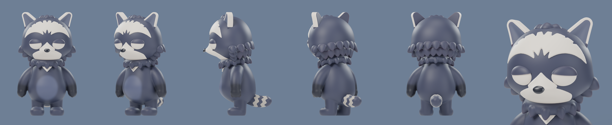
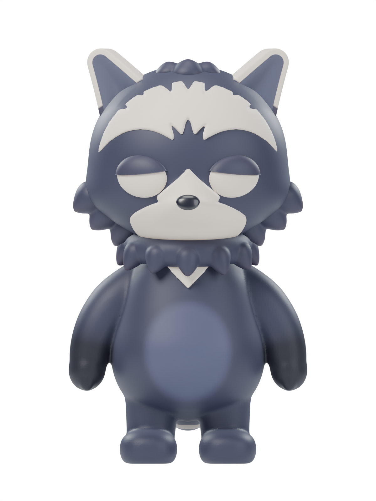
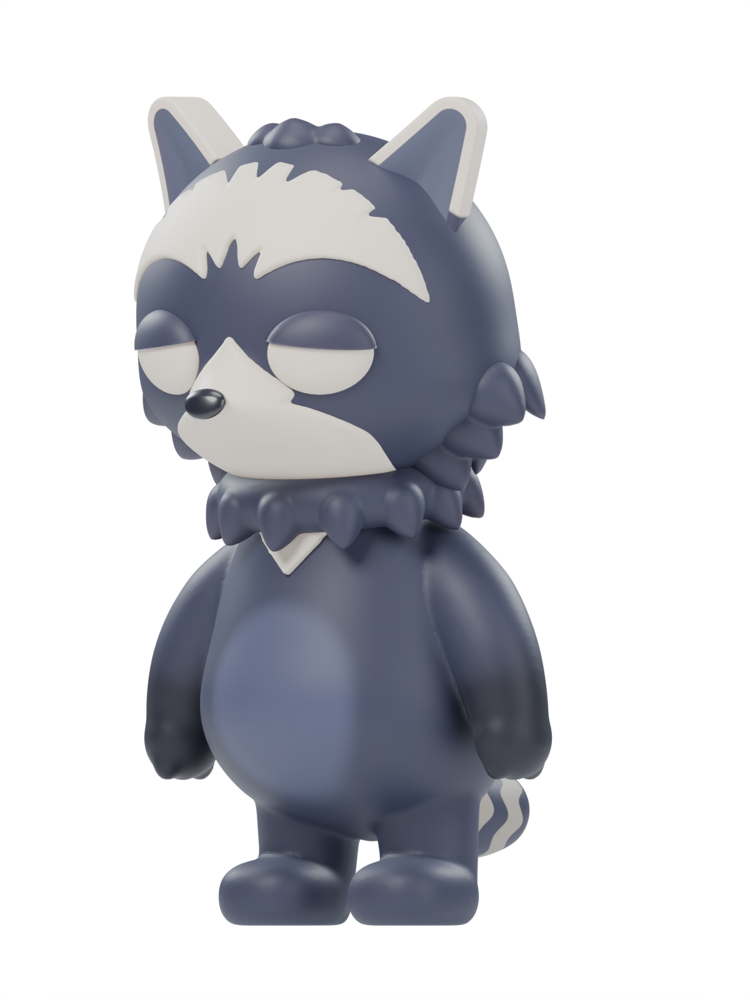
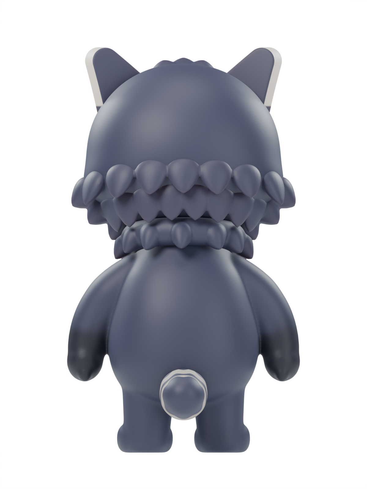
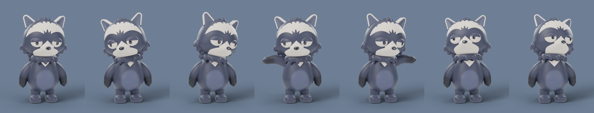

# Blender Pet · ChambaLab

**El hogar de los modelos y renders de Blender de ChambaLab.**

Aquí vivirán las escenas editables, las hojas de personaje y los renders de nuestros personajes: vistas, expresiones y poses listas para usar en la web y en piezas visuales.

## 🦝 Primer personaje: el mapache

Un mapache de acabado mate, pelo pizarra y detalles crema. La hoja de personaje sirve como referencia visual del modelo desde distintos ángulos.

  
  
  

## 🎬 Poses y miradas

Exploraciones de reposo, curiosidad, presentación y mirada hacia arriba. Las poses se configuran en JSON y se renderizan con los scripts del proyecto.

## 📦 Qué encontrarás aquí

| Ruta | Contenido |
| --- | --- |
| [`mapache/mapache.blend`](mapache/mapache.blend) | Escena principal editable en Blender. |
| [`mapache/scripts/`](mapache/scripts/) | Construcción del personaje, materiales, luces, cámaras y poses. |
| [`mapache/sheet/`](mapache/sheet/) | Hoja de personaje y vistas renderizadas. |
| [`mapache/poses/`](mapache/poses/) | Renders de poses y su configuración JSON. |

## 🛠️ Trabajar con el proyecto

1. Clona este repositorio y abre `mapache/mapache.blend` en Blender.
2. Para modificar o generar vistas y poses, consulta los scripts de `mapache/scripts/`; se ejecutan dentro de Blender.
3. Los scripts resuelven sus rutas desde el archivo `.blend`: guarda y abre `mapache/mapache.blend` antes de ejecutarlos.

La reconstrucción de la cara con `build_m2_face.py` requiere la referencia local `mapache/references/highsfield3.png`, que no se distribuye. Puedes abrir el modelo guardado sin reconstruirlo desde los scripts.

## Skill de referencia

La carpeta [`skills/personaje-vinilo-blender/`](skills/personaje-vinilo-blender/) conserva una copia de la skill compartida para crear personajes de vinilo en Blender, con sus scripts, plantillas y referencias. Consulta su [README](skills/personaje-vinilo-blender/README.md) y su [SKILL.md](skills/personaje-vinilo-blender/SKILL.md).

Se incluye como referencia del proceso; los cambios en la carpeta compartida no se sincronizan automáticamente.

## 🔒 Archivos locales

Este repositorio conserva los modelos, los scripts y los renders seleccionados. La configuración local, las referencias originales, los borradores, las capturas intermedias, los experimentos y los backups quedan excluidos mediante `.gitignore`.

## Licencias

El modelo y los renders se publican bajo [CC BY 4.0](LICENSE-CC-BY-4.0). Los scripts, la configuración de poses, la skill y la documentación se publican bajo [MIT](LICENSE-MIT). Consulta el [alcance y ejemplo de atribución](LICENSE.md).
